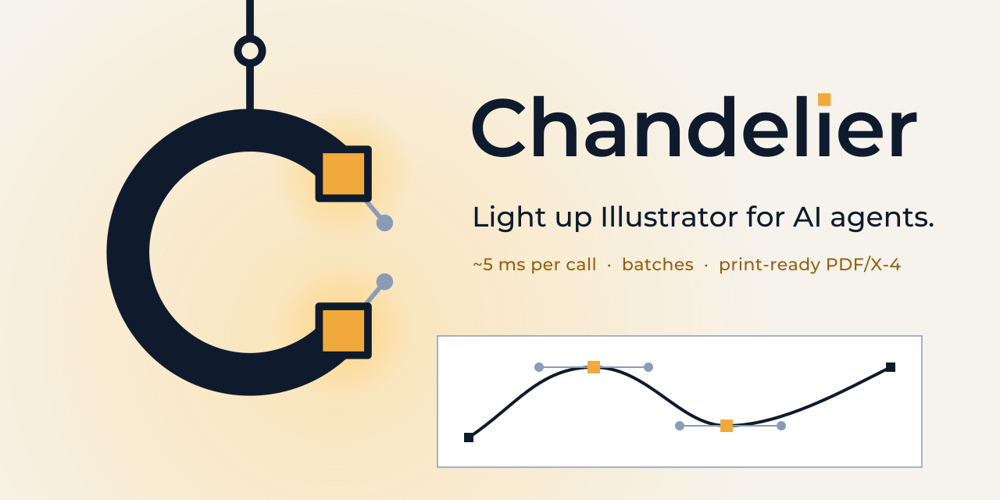

<h1 align="center">
  <picture>
    <source media="(prefers-color-scheme: dark)" srcset="docs/assets/brand/hero-dark.svg">
    
  </picture>
</h1>

<p align="center">
  <a href="LICENSE"></a>
  <a href="https://www.npmjs.com/package/chandelier-mcp"></a>
  
  
  
  <a href="https://ko-fi.com/acidka"></a>
</p>

**Chandelier** is an [MCP](https://modelcontextprotocol.io) server that lets AI agents — Claude Code, Claude Desktop,
Cursor and other MCP clients — work in **Adobe Illustrator**: build print-ready documents, edit them, look at the
result and export. It keeps **one persistent connection** to Illustrator, so a call costs **~5 ms instead of
~330 ms**, and a whole page is built in **one call**.

> *Chandelier* is *люстра* in Ukrainian, and «люстра» is what Ukrainian designers call Illustrator. A project that
> hangs over Illustrator and lights it up for AI agents.

## Why

Driving Illustrator from an agent used to mean a choice: write ExtendScript files (fast, but blind and fiddly) or
call an MCP server tool by tool (convenient, but hundreds of slow calls). Chandelier is both: typed tools, batches and
a full scripting escape hatch over one fast connection, plus the print features real jobs need.

Measured with fresh Claude agents on the same jobs (2026-11-22, Illustrator 29.1, Apple M1):

| Job | ExtendScript files | [ie3 MCP](https://github.com/ie3jp/illustrator-mcp-server) | **Chandelier** |
|-----|-------------------:|-----------------------:|---------------:|
| **Recreate a design from an image** — time | 2.5 min | 5.0 min | **1.2 min** |
| tool calls · input tokens | 16 · 0.81 M | 103 · 3.21 M | **11 · 0.42 M** |
| **12-page calendar from a screenshot** — time | 2.7 min | 21.4 min | **2.0 min** |
| tool calls · input tokens | 17 · 0.94 M | 365 · 13.3 M | **17 · 0.78 M** |
| **Overhead per call** | ~150 ms | ~330 ms | **~5 ms** |

All Chandelier files scored 9–10 of 10 on the quality checklists, with global swatches, paragraph styles and a real
bleed. Methods, every run and the caveats (one run per arm for the latest numbers): [benchmarks](docs/research/benchmarks.md).

## Quick start

**Needs:** macOS or Windows 11, Adobe Illustrator 2025 or later, running (tested on 29.1 on macOS and 2027 / 31.0 on
Windows 11 ARM64), and Node.js 22.15 or later for the Claude Code and `npx` routes.

**Claude Code — plugin (recommended):** the MCP server, an Illustrator skill and the `/ai-preview` and `/ai-preflight`
commands.

```
/plugin install chandelier --marketplace acidka/chandelier
```

On Claude Code older than 2.1.275: `/plugin marketplace add acidka/chandelier`, then `/plugin install chandelier@chandelier`.

**Claude Desktop:** download `chandelier-<version>.mcpb` from the [releases](https://github.com/acidka/chandelier/releases)
and open it (or **Settings → Extensions → Install extension**). It brings its own dependencies and runs on Claude
Desktop's built-in Node.

**Any MCP client — server only:**

```sh
claude mcp add chandelier -- npx -y chandelier-mcp            # Claude Code, macOS
claude mcp add chandelier -- cmd /c npx -y chandelier-mcp     # Claude Code, Windows
```

```json
{ "mcpServers": { "chandelier": { "command": "npx", "args": ["-y", "chandelier-mcp"] } } }
```

On Windows use `"command": "cmd", "args": ["/c", "npx", "-y", "chandelier-mcp"]`: Windows has only `npx.cmd`, no `npx`
executable. The plugin and the Claude Desktop bundle handle this themselves.

Chandelier is also listed in the official [MCP Registry](https://registry.modelcontextprotocol.io/v0.1/servers?search=io.github.acidka/chandelier)
as `io.github.acidka/chandelier`, for clients that install servers from it.

Then ask your agent for something (see [what you can ask](#what-you-can-ask)).

<details>
<summary><b>Setup notes</b>: permissions, Node version, smaller tool list, debug log, from source</summary>

- **macOS:** on the first call macOS asks whether your terminal (or app) may control Illustrator. Allow it, or later in
  **System Settings → Privacy & Security → Automation**.
- **Windows:** nothing to allow. Run Illustrator and your MCP client at the same level (both normal, or both "Run as
  administrator"). The first start compiles a small helper (a few seconds); later starts reuse it. Illustrator can't
  save or open files whose path is 260 characters or longer; the server refuses those with a message.
- **Node version:** the plugin and `npx` start the server with the first `node` on your PATH. If that is older than
  22.15 (an old nvm default, for example), the server says so through its `status` tool instead of starting. Install a
  current Node and make it the default (`nvm install 22 && nvm alias default 22`, or `brew install node`), or give the
  full path of a newer `node` as the command, then restart your MCP client.
- **Smaller tool list:** clients that load every tool schema up front can set `CHANDELIER_TOOLS=lean`: the eight tools
  a build uses plus a `tools` tool that lists, explains and calls the rest — about 4.9 k tokens per request instead of
  16.2 k ([benchmarks](docs/research/benchmarks.md#tool-list-size)). A design-from-image run with it scored 10 of 10
  with no extra tool calls ([run](docs/research/benchmarks.md#m2-with-the-lean-tool-profile--2026-11-24-arm-c2-1-run-040)).
  A comma-separated list of tool names works too.
- **Debug log:** `CHANDELIER_LOG=debug` writes one JSON line per tool call (tool, time, result) to stderr;
  `CHANDELIER_LOG_FILE=/path/to/file` appends them to a file.
- **From source:**

  ```sh
  git clone https://github.com/acidka/chandelier.git && cd chandelier
  npm install && npm run build      # then point your client at node /absolute/path/to/chandelier/dist/index.js
  ```

</details>

## Features

- **Fast.** One long-lived bridge process and a helper runtime loaded into Illustrator once; each call sends only a
  command and its arguments. `batch` runs up to 1 000 tool steps in one round trip.
- **Short build loop.** Create a document, one batch for swatches and styles, one for content, one check
  (`preview {reference, preflight: true}`), one finish (`documents save {export: [...]}`) — about eight
  calls to Illustrator for a page.
- **Full power when tools aren't enough.** `run_script` runs ExtendScript with a helper library (`AIA.text`,
  `AIA.swatch`, `AIA.at(artboard, …)` …), re-runnable `.jsx` builders with arguments, and ready recipes (calendar
  month, labels sheet, business card, style guide, colour chips).
- **It looks at its work.** `preview` returns an image of an artboard, items or a region. Given a reference image, it
  reports how far the content is shifted or scaled and lists each difference — moved (by how much), missing, extra or
  changed — with the items there.
- **Print-ready.** CMYK documents with real bleed, global process and spot swatches, paragraph and character styles,
  PDF/X-4 export with exact trim and bleed boxes and output intents (FOGRA39, GRACoL…), spread traps, colour
  conversion. `preflight` checks what matters (RGB in CMYK, missing fonts, overset text, hairlines, low-res images,
  white overprint…), skips non-printing layers, and can check brand rules (allowed colours, fonts, sizes; contrast).
- **Production runs.** `data_merge` fills a template from CSV or JSON (`{{name}}` in any text, swapped photos,
  colours, optional parts) into one artboard per row, n-up sheets, or one PDF/PNG per row. `batch {files}` runs the
  same steps over a folder and saves copies. `swatches {recolor}` snaps every colour to a brand palette, also from an
  `.ase` library. Exports per layer set (with and without the dieline) and screen assets at 1x/2x/3x.
- **Effects and more.** Live, editable effects (drop shadow, glows, round corners, feather, blur, offset, roughen,
  zigzag, transform copies…), symbols, image trace.
- **Safe by design.** Never launches Illustrator unless asked, never touches documents it didn't create or wasn't
  asked to change, removes what a failed call created, retries Illustrator's transient errors, and explains crashes
  and timeouts in plain words (and whether the timed-out call finished).
- **Agent-friendly.** Compact responses, conventions sent once in the server instructions, errors that say what to do
  next, and two ready prompts: `recreate_design` and `print_export`.

## What you can ask

> Recreate the poster in `poster.png` as an editable CMYK A3 document with a 3 mm bleed, using global swatches and
> paragraph styles, and export a PDF/X-4.

> Make a 2027 wall calendar: 12 A4 landscape pages, Monday first, ISO week numbers, weekends in red.

> Preflight the open document, fix every error, and tell me what you changed.

> Change the brand colour everywhere to `cmyk(100, 60, 0, 10)` and export PNG previews of every artboard.

> Make a certificate for every row of `attendees.csv` and export one PDF per person, named after them.

> Give the product cards a soft drop shadow and rounded corners, then export a PDF/X-4 for a FOGRA39 press.

> Open every `.ai` in `~/jobs/spring`, snap all colours to the swatches in `brand.ase`, and save copies to `~/jobs/out`.

## Tools

35 tools; every tool that changes a document can also be a step inside `batch`.

| Group | Tools |
|-------|-------|
| Session and documents | `status` · `configure` · `documents` · `document_info` · `history` |
| Inspect | `find_items` · `get_items` · `get_tree` · `selection` · `fonts` |
| Create | `create_text` · `create_shape` · `create_path` · `place` |
| Edit | `edit_text` · `modify_items` · `transform_items` · `duplicate_items` · `arrange_items` · `align_items` · `path_ops` · `delete_items` |
| Structure, colour and effects | `layers` · `artboards` · `swatches` · `styles` · `effects` |
| Build | `batch` (also over many files) · `run_script` · `data_merge` · `menu_command` · `symbols` |
| Look, check, output | `preview` · `preflight` · `export` |

Coordinates in every tool: `[x, y, w, h]` from the artboard's top-left, y down, in the session's units (pt, mm, in
or px). Full catalogue: [plan § 6](docs/plan.md#6-tool-catalogue); how agents should use them:
[agent guide](docs/agent-guide.md).

## How it works

```
AI agent ──MCP (stdio)──▶ Chandelier server (Node.js)
                              │  one persistent bridge process:
                              │  macOS: osascript / JXA (Apple events) · Windows: PowerShell + COM (DoJavaScript)
                              ▼
                          Adobe Illustrator ── AIA runtime (ExtendScript, loaded once per Illustrator session)
```

Each tool call becomes one Apple event (macOS) or COM call (Windows) that runs one runtime command; the runtime
reloads itself after Illustrator restarts. Architecture, decisions with their pros and cons, and the measurements
behind them: [plan](docs/plan.md).

## Status

Current release: **0.4.1** (2026-11-24) on macOS and Windows — npm, MCP Registry, Claude Code plugin and Claude Desktop bundle.

| Release | Date | What it added |
|---------|------|---------------|
| **0.4.1** | 2026-11-24 | Listed in the MCP Registry; README rewritten |
| **0.4** | 2026-11-24 | Look and print depth: live effects, spread traps, colour conversion, PDF/X output intents, a visual diff that says what moved (and by how much), what's missing and what's extra |
| **0.3** | 2026-11-24 | Production automation: `data_merge`, `batch {files}`, `swatches {recolor, import}`, the `lean` tool profile |
| **0.2.1** | 2026-11-24 | Recipes, brand checks, export variants and screen assets, symbols, image trace, safe restart, debug log; fix: a tint no longer changes the swatch itself |
| **0.2** | 2026-11-24 | **Windows**: the same tools over a PowerShell/COM bridge ([plan](docs/windows-plan.md)); all live suites pass with Illustrator 2027 on Windows 11 ARM64; design from an image in 1.5 min, 11 tool calls, 10 of 10 ([benchmarks](docs/research/benchmarks.md#1b-windows-02-phase-7-w7--2026-11-24)) |
| **0.1** | 2026-11-23 | First release on macOS: npm, Claude Code plugin, Claude Desktop bundle |

Everything planned and done: [roadmap](docs/roadmap.md).

## Documentation

| | |
|---|---|
| [Agent guide](docs/agent-guide.md) | How an agent should build, check and export with Chandelier |
| [Plan](docs/plan.md) | Goals, architecture, decisions with pros and cons, tool catalogue, risks |
| [Roadmap](docs/roadmap.md) | Phases, milestones, what's done and what's next |
| [Benchmarks](docs/research/benchmarks.md) | Every measurement, method and run |
| [Illustrator quirks](docs/research/illustrator-quirks.md) | Known Illustrator failures and how Chandelier handles them |
| [All docs](docs/README.md) | The full index |

## Develop

```sh
npm test            # unit tests, no Illustrator needed
npm run lint:jsx    # ES3 lint of the ExtendScript runtime
npm run typecheck
npm run test:live   # live suites: need Illustrator running; work only in documents they create
npm run bench       # micro benchmark (ExtendScript files / ie3 MCP / Chandelier)
npm run build:mcpb  # Claude Desktop bundle in build/
claude plugin validate plugin   # the Claude Code plugin (plugin/) and its marketplace (.claude-plugin/)
```

Rules for contributors and coding agents: [AGENTS.md](AGENTS.md).

## Support

Chandelier is free and open source, built in spare time. If it saves you time in Illustrator, you can buy me a
coffee on Ko-fi:

<a href="https://ko-fi.com/acidka"></a>

## Licence

Code: [MIT](LICENSE). The logo and hero images are not covered by the MIT licence: see [brand](docs/brand.md#licence).
Adobe and Illustrator are trademarks of Adobe Inc.; this project is not affiliated with or endorsed by Adobe.
